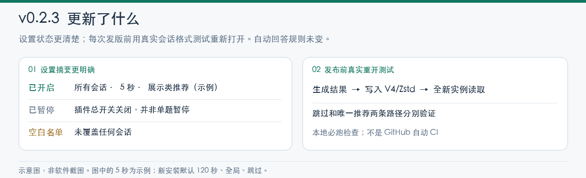

# dsh-auto-decide

**让普通提问少打断你，重要决定仍由你做。** 这是 DSH 的 `ask_user_question` 超时处理插件：你在等待时间内回答，就用你的答案；到时没有回答，插件才按设置跳过，或选择符合严格条件的展示类推荐项。


*规则示意，非软件截图；图中的 5 秒只是例子，新安装默认等待 120 秒。*

## 开始使用

在 DSH「插件 → 添加插件」安装固定版本：

```text
github:nico-zhuang/dsh-auto-decide#v0.2.3
```

然后到「插件 → 已安装插件 → dsh-auto-decide → 组件配置」核对开关、适用会话、等待秒数和到时处理方式。**新安装默认已开启、所有会话、120 秒后跳过**；如果要选择推荐项，需自己切换到推荐模式。可设置 1–3600 秒。

| 到时处理 | 实际动作 |
| --- | --- |
| **跳过**（默认） | 所有普通问题返回空选项，继续执行；**跳过不是同意**。 |
| **仅展示类推荐项** | 只有展示／外观／格式／语言类**单选题**，且题目和选项都符合规则、恰有一个选项以 `(Recommended)` 结尾时才选它。其余情况回退跳过，不猜第一个选项。 |

例如“选择预览的显示格式？”里只有“紧凑显示 (Recommended)”带推荐标记，启用推荐模式后可以自动选择；**被规则识别出的**部署、支付或授权类表述会回退跳过。文字规则无法保证识别所有风险，更不是可靠的语义安全审查。

### 哪些会话生效

- **所有会话**（默认）：当前和以后新建的会话都在范围内。
- **仅选中会话**：只有保存进名单的会话生效；名单为空时没有任何会话生效，新会话不会自动加入。
- **排除选中会话**：名单中的会话交给人工，其余会话生效；新会话也会在范围内，空名单等同所有会话。

名单按稳定会话 ID 保存，可按标题或 ID 搜索并选择已归档会话。不在范围内的普通提问走原本的人工流程。真人抢先回答优先；插件停用或等待中改配置，不会继续使用旧设置自动作答。

## v0.2.3 更新



1. **当前状态更清楚**：插件设置摘要显示“已开启／已暂停”；已开启但选中的会话名单为空时显示“未覆盖任何会话”。这里的“已暂停”指**插件总开关关闭**，不是单题暂停按钮。
2. **发版前多一道重开检查**：`npm run test:release` 除了单元测试，还用真实 DSH 0.2.1-rc.2 V4/Zstd 会话格式测试“跳过”和“选推荐项”两种自动结果：写入、关闭，再由新实例严格读取。

**自动回答规则与 v0.2.2 相同。** 没有加入提问卡片倒计时、单题暂停／继续或“这题我自己答”按钮。[查看 v0.2.3 发布说明](https://github.com/nico-zhuang/dsh-auto-decide/releases/tag/v0.2.3)。

## 安全边界与旧会话

- 只处理来自模型工具 `ask_user_question` 的**普通提问**；计划审阅和独立安全审批不在处理范围内。自动结果会标明插件来源和“未经人工确认”，不冒充用户批准。
- **敏感词过滤不是语义安全审查。** 没有匹配到推荐项时可能会跳过并继续执行，跳过不能代替必要的人工确认或审批。重要会话建议先用“仅选中会话”限定范围，再用无风险的格式问题测试。
- **不要继续用 v0.2.1 触发自动回答。** v0.2.1 曾写入缺少身份字段的自动消息，导致某些会话重新打开时被拒绝；v0.2.2 起避免新的同类写入，v0.2.3 在发版前增加重开测试。**升级不能修好此前已经打不开的会话。** 请保存原始会话文件，不要删除事件或清理索引碰运气。

<details>
<summary>安装补充、技术细节与本地测试</summary>

桌面内置 CLI 可用 `dsh plugin --profile desktop add 'github:nico-zhuang/dsh-auto-decide#v0.2.3'` 原位更新并固定标签。若安装器要求重启，须重启桌面宿主；不手工编辑 profile 或应用包。回滚使用 DSH 插件管理器停用或卸载。

配置由 DSH Config Forms 持久化。推荐只在题干和唯一推荐选项都明确涉及展示／外观／格式／语言时匹配；多选、陌生领域、缺失或重复的 `(Recommended)`、敏感操作表述均回退跳过。与 DSH 自带 `timed` 提问不同，本插件的等待计时由 Host 独立运行，原生问题卡片上的计时或“慢慢回答”不会控制它。

在 Node 24 环境中运行发布前检查：

```bash
npm install --ignore-scripts --no-audit --no-fund --no-package-lock
npm run test:release
```

检查包含语法、单元测试和真实 V4/Zstd 会话冷重载；隔离依赖与合成测试数据放在系统临时目录，不接触真实会话。发布者须在打标签前亲自确认命令成功；**仓库目前没有 GitHub 自动 CI 门禁**。

</details>
